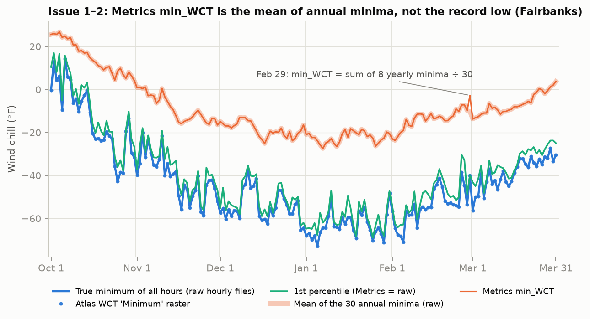
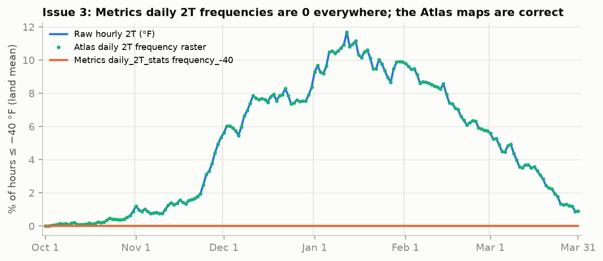
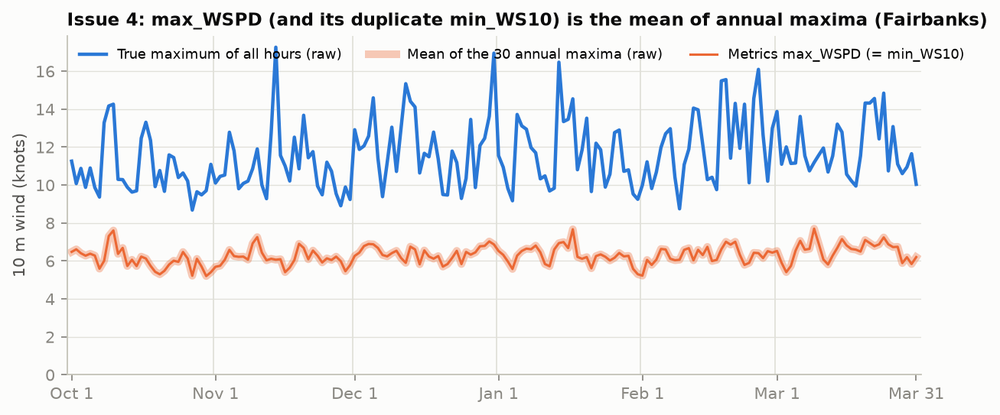
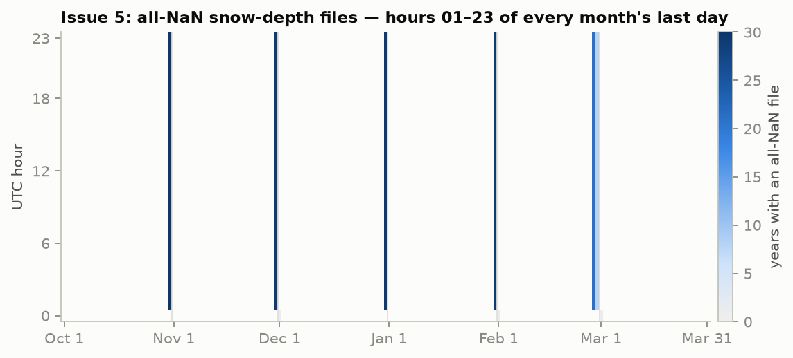
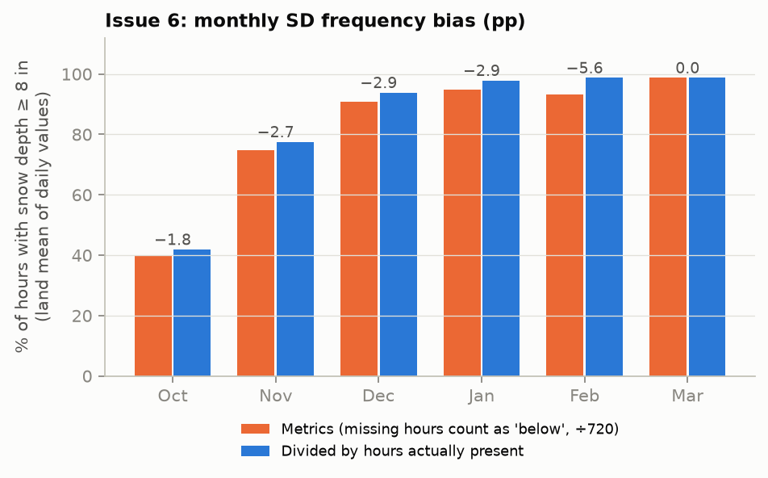
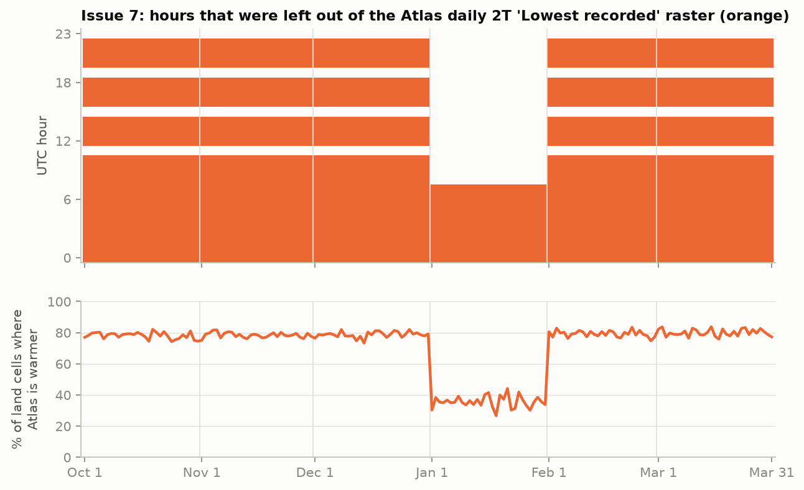
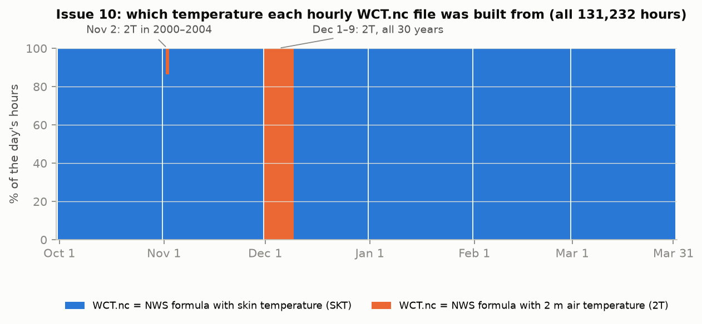
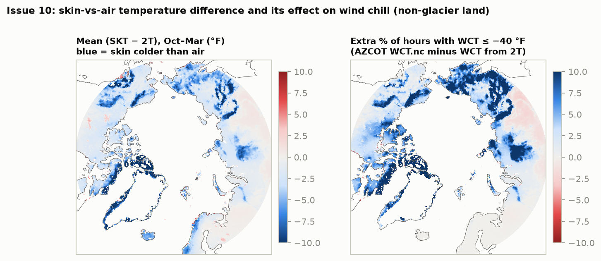
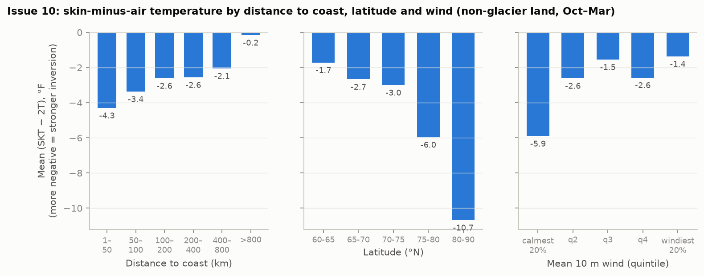
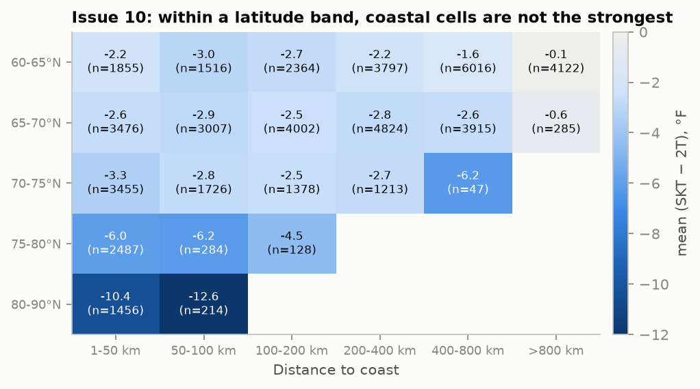

# Verification of the High and Medium issues in AZCOT_DATA_ISSUES.md

*SNAP, 12 October 2026. Independent re-check of issues 1, 2, 3, 4, 5, 6, 7 and 10 before the document goes to the authors.*

## How the checks were done

- **Clean-room code.** Everything in `verification/scripts/` was written fresh for this check. It imports nothing from `eda/` or `preprocess/` and reads only the original AZCOT files (read-only), so a bug in our earlier pipeline can't carry over.
- **Full coverage.** Every grid cell, every one of the 183 calendar days, and every hourly file: 131,232 hours each of 2T, SKT, WCT, WS10 and SWE, and all 131,232 snow-depth files. The tolerance for "equal" is 0.001 in the variable's own units. The files are float32, so real matches come out at about 1e-5.
- **Independent sources where possible.** These were the GRIB files that the netCDF files were converted from, and the separate AKCASC copy of ERA5 and ERA5-Land (`/import/AKCASC/data/cds`).
- **The authors' own description and code.** TR-26-5 §2, SR-25-2 §2–3, `disk1/README.docx`, the Atlas map captions in `zScripts/AZCOT_Map_Creation.ipynb`, and the published scripts `zScripts/metricCalculation_frequency.py` and `metricCalculation_consecutive.py`.

## Verdicts

| # | Claim in the document | Verdict | What needs to change |
|---|---|---|---|
| 1 | `min_WCT`, `min_2T` are means of annual minima | **Confirmed, everywhere** | Say it is the **daily** files only (the 6-h files hold true minima); add `min_SKT`; cite the published script as the likely mechanism |
| 2 | Feb 29 `min_WCT` = sum of 8 minima ÷ 30 | **Confirmed** | Also affects `min_2T`, `min_SKT` and all `consecutive_*` fields on Feb 29; the spike is on Feb 29, not Mar 1 |
| 3 | 2T frequencies are 0% because thresholds hit kelvin | **Confirmed for the daily files only** | **Wrong for `6h_2T_stats`** (correct °F values); **`consecutive_*` are correct**, not "very likely affected"; the Atlas 2T frequency maps are correct; consider lowering severity |
| 4 | `max_WSPD` duplicates `min_WS10` | **Reframe** | Both hold the **mean of the 30 annual maxima**, i.e. the same convention as issue 1. "One field copied into the other" is speculation that the data don't support. |
| 5 | SD hours 01–23 of every month's last day are missing | **Confirmed** | **February count is 668, not 484** (Feb 29 omitted); add the mechanism and the upstream check |
| 6 | SD frequencies biased by the missing hours | **Confirmed** | "About 3 pp" → **1.8–2.9 pp (Oct–Jan), 5.6 pp (Feb), 0 (Mar)** |
| 7 | Atlas 2T "Lowest recorded" is not the true minimum | **Confirmed, mechanism found** | The raster is the exact minimum over **only 4 of 24 UTC hours** (11, 15, 19, 23) on 152 days, and over 08–23 UTC in January; update the shares to the full-season values |
| 10 | WCT is computed from SKT, not 2T | **Confirmed for 95% of hours; not universal** | **Dec 1–9 (all years) and Nov 2 (2000–2004) use 2T.** Drop "coasts" from the inversion sentence. Update the impact numbers. |

None of the eight issues turned out to be a false accusation of a data error, so each still stands. But issues 3, 4 and 10 overstate or mis-describe the problem as written, and issues 5 and 6 contain wrong numbers. Concrete replacement text is in [Proposed changes](#proposed-changes-to-azcot_data_issuesmd).

---

## Issue 1: `min_*` is a mean of annual minima

**Result.** On all 182 non-leap days, `min_WCT`, `min_2T` and `min_SKT` in `daily_*_stats` equal **sum of the 30 annual minima ÷ 30** in **100% of the 174,240 cells** (max difference 1.2e-4). They never equal the true minimum. `min_WCT` is warmer than `percentile_1` in every cell on every non-leap day, with no exceptions. It sits 17–25 °F above the true minimum on average (daily grid means) and up to 74 °F above in a single cell.

**The 6-h files are different.** Every 6-h minimum is the **true** minimum of its 180 hours, with a difference of exactly 0. That holds for WCT (`min_stl1` in 604 files, `min_wct` in 124), 2T (`min_2T`) and SKT (`min_skt`), and likewise for `max_wspd`. The daily Atlas WCT minimum rasters also equal the true minimum (difference 0, every cell, every day). So the problem is confined to the **daily** Metrics files.

**Likely mechanism, from the authors' own code.** `zScripts/metricCalculation_consecutive.py` computes the extreme **per year**, adds up the yearly results and divides by a hard-coded `num_years = 30`. The daily files contain exactly that script's fields (`consecutive_*` plus the extreme). The 6-h files contain only the fields of `metricCalculation_frequency.py`, which takes the true minimum (`df_min.min(axis=1)`). The reports (TR-26-5 p. 12; SR-25-2 §3.2, Plate 2) and `disk1/README.docx` all describe the extreme as the single lowest value.

All quoted values reproduce: Fairbanks Jan 15, −18.70 / −18.70 / −62.66; Utqiagvik, −41.17 / −41.17 / −75.52; Fairbanks `min_2T` 251.90 K = −6.25 °F.

*Figure 1. Fairbanks, every day of the season. The Metrics `min_WCT` line (orange) lies exactly on the mean of the 30 annual minima (pale orange). The true minimum and the Atlas raster (blue) are 20–50 °F colder. The Feb 29 spike is issue 2.*

## Issue 2: Feb 29 divides by 30

**Result.** On Feb 29, `min_WCT`, `min_2T` and `min_SKT` all equal sum(8 yearly minima) ÷ 30 in 100% of cells (difference 4e-6 to 1.5e-5). **New:** all 32 WCT `consecutive_*` fields on Feb 29 are also sum ÷ 30 (difference 6e-6); dividing by 8 instead would change them by up to 17.6 h. This matches the hard-coded 30 in the published consecutive script. `averageTemp` and `percentile_*` are correct on Feb 29. `max_WSPD` is the exception: on Feb 29 it is the mean over the 8 years, and `min_WS10` is sum ÷ 30.

The quoted values reproduce: Utqiagvik −11.14 / −11.14 / −41.77; Fairbanks −2.76 / −2.76 / −10.36. In a daily series the jump appears **on Feb 29** itself, between Feb 28 and Mar 1. The document currently says "a spike at Mar 1".

## Issue 3: `daily_2T_stats` frequencies are zero

**Confirmed for the daily files.** `daily_2T_stats` stores kelvin: `averageTemp` and `percentile_1` match the raw kelvin values. All 16 `frequency_*` fields are **exactly 0 in every cell on every day**, while raw 2T in °F is at or below −40 °F somewhere on every day (611–50,923 cells). Fairbanks Jan 15 reproduces: 255.14 K = −0.42 °F, 22.5% of hours at or below −20 °F, 4.9% at or below −40 °F.

**Two statements in the document are wrong:**
- **`6h_2T_stats` frequencies are correct °F values.** They match raw °F counts in at least 99.9% of cells on every day; the remainder are threshold ties.
- **Daily 2T `consecutive_*` fields are correct °F values.** They match in at least 99.8% of cells, again with ties as the only differences. The document says they are "very likely affected".

**The Atlas 2T daily frequency rasters are correct** (at least 99.9% of cells equal the raw °F frequency), so the published maps are not affected. That probably justifies **Medium** rather than High severity.

*Figure 2. Land-mean share of hours at or below −40 °F, by day. The Metrics daily field is 0 all season, while the raw data and the Atlas raster agree.*

## Issue 4: `max_WSPD` is a mean of annual maxima

**Wind units: confirmed knots.** In one random hour on each of the 183 days (full grid), `WS10` = hypot(10U, 10V) × 1.94384, with the ratio identical in every cell, every hour. The AKCASC u10/v10 values match the GRIB to within 0.0015 m/s. `averageWSPD` and all `frequency_*` match raw knots exactly. The quoted example reproduces (1994-01-15 23 UTC, 62.0°N 47.75°W: 34.99 m/s = 68.02 kn = `WS10`).

**The field is a convention problem, not a copy.** `max_WSPD` and `min_WS10` are bit-for-bit identical on all 182 non-leap days. **Both equal the mean of the 30 annual maxima** in every cell (difference 1.1e-5), and neither ever equals the true maximum. That is the same per-year-then-average pattern as issue 1, and it is what `metricCalculation_consecutive.py` does for `max_WSPD`. `min_WS10` is a second, misnamed copy of it. The 6-h `max_wspd` is the true maximum.

*Figure 3. Fairbanks: Metrics `max_WSPD` (orange) lies on the mean of annual maxima. The true maximum (blue) is roughly twice as large.*

## Issue 5: missing snow-depth hours

**Confirmed, all 131,232 files scanned.** Every file exists, and the valid time stored in each file matches its name. The all-NaN files are hours 01–23 UTC on the last day of every month in every year, plus 00 UTC on 2008-12-01, 2010-02-01 and 2019-03-01. Every other file has the same 383,866 land cells.

| Month | Oct | Nov | Dec | Jan | Feb | Mar |
|---|---:|---:|---:|---:|---:|---:|
| All-NaN files (document) | 690 | 667 | 668 | 667 | **484** | 1 |
| All-NaN files (this check) | 690 | 667 | 668 | 667 | **668** | 1 |

The February figure in the document leaves out Feb 29 (8 years × 23 h = 184). February is 483 on Feb 28 (21 non-leap years), plus 184 on Feb 29, plus the 2010-02-01 hour.

**Mechanism (new).** Every missing field belongs to the **00 UTC ERA5-Land forecast cycle that starts on the last day of the month**. The files' own reference time is the last day, steps 1–23. In the three months where the last day is complete (Nov 2008, Jan 2010, Feb 2019), it is that cycle's step 24 (00 UTC on the 1st) that is missing instead. In other words, the cycle that straddles two monthly downloads lost its hours on one side. March is never affected.

**The data exist upstream.** On all 146 month-end dates where AZCOT's 12 UTC file is empty, the AKCASC ERA5-Land copy (daily 12 UTC `sde`) has a full 383,866-cell field. On 642 normal dates it matches AZCOT to within its packing precision (2.5e-4 m). So re-downloading or re-converting would fix the gap.

## Issue 6: SD frequencies biased low

**Confirmed.** In every cell on every day, the Metrics `frequency_8/15/20/40` equal count ÷ 720 with missing hours counted as "not exceeding" (difference 3e-6). Multiplying by 720 and dividing by the hours actually present reproduces the true frequency (difference 4e-6). `averageSL` (the SD mean) and `max_SD` are correct, **in metres** (difference 3e-4 m), as the document's §8 says.

The monthly bias (land mean of daily `frequency_8`, the way the Atlas aggregates) is **1.8 pp in October, 2.7–2.9 pp in November–January, 5.6 pp in February (Feb 28 and Feb 29 are both affected) and 0 in March**. "About 3 pp" fits only November–January.

## Issue 7: Atlas 2T "Lowest recorded" rasters

**Confirmed, all 183 days, 61,532 land cells (11.3 million cell-days).** The raster equals the true minimum in **28.4%** of cell-days, is warmer in **71.6%**, and is never colder. (The document's 27% / 73% came from every 7th day.) The six worst days have land-mean differences of 1.5–2.3 °F and single-cell differences of 29–34 °F. The 66.0°N 67.0°E example reproduces exactly: −40.2 °F in the raw data vs −6.3 °F in the Atlas, with 1992-11-03 22 UTC to 11-04 02 UTC all at or below −37 °F.

**Mechanism (new).** In 100% of cells on every day, the raster equals the **exact minimum over a fixed subset of UTC hours** (all 30 years):
- **Oct–Dec and Feb–Mar (152 days): only 11, 15, 19 and 23 UTC.** The other 20 hours are never used.
- **January (31 days): 08–23 UTC.** Hours 00–07 are never used.

The Atlas **6-h** 2T rasters equal the true 6-h minima exactly, and the Atlas WCT daily rasters equal the true daily minima. So only the daily 2T extreme step is affected. The Nov 4 example fits: the Atlas value is the minimum of 11, 15, 19 and 23 UTC.

*Figure 4. Top: UTC hours that hold a value colder than the Atlas raster somewhere, so they cannot have been in its pool (orange). Bottom: share of land cells where the Atlas value is warmer than the true minimum.*

## Issue 10: wind chill from skin temperature

**Mostly confirmed, but not universal.** Every one of the 131,232 hourly `WCT.nc` files matches exactly one version of the NWS formula (TR-26-5 eq. 3, wind in true mph = knots × 1.150779) to within 0.01 °F in every cell. None matches neither.

| Temperature used | Hours | Share | When |
|---|---:|---:|---|
| Skin temperature (SKT) | 124,653 | 95.0% | all other days |
| 2 m air temperature (2T), as documented | 6,579 | 5.0% | **all hours of Dec 1–9 in all 30 years**; Nov 2 in 2000–2003 (all hours) and 3 hours in 2004 |

The labels are right: `2T.nc` and `SKT.nc` match their GRIB files (parameter `2t`, `skt`), and `2T.nc` matches the independent AKCASC t2m to within its packing precision. Treating the wind as knots-as-mph misses by at least 1.3 °F somewhere in the grid in every hour. TR-26-5 eq. 3, SR-25-2 eq. 3 and the Atlas captions ("2m temperature and 10m wind") all document 2T. The earlier "40 of 40 random hours" sample happened to miss Dec 1–9.

**Impact, re-derived.** The cells are the Atlas land mask minus ERA5 glacier-cap cells (SL ≥ 2000 lb/ft² in every hour), 51,567 cells, unweighted means.

| | Jan 15: AZCOT WCT.nc | Jan 15: WCT from 2T | Oct–Mar: AZCOT WCT.nc | Oct–Mar: WCT from 2T |
|---|---:|---:|---:|---:|
| Mean WCT difference (2T − file) | | +4.2 °F | | +3.1 °F |
| Record low, mean difference | | +4.7 °F (p95 +18, max +38) | | +5.1 °F (p95 +17, max +35) |
| Cells where 2T gives a *colder* record | | 24% | | 17% |
| % of hours ≤ −40 °F | 46.9 | 39.7 | 26.6 | 21.5 |
| % of hours ≤ −65 °F | 11.1 | 5.4 | 4.4 | 2.0 |

The site values in the document reproduce exactly: Eureka 86.7 vs 58.5% of hours ≤ −40 °F on Jan 15; Utqiagvik −75.5 vs −69.9 °F; Oymyakon −84.2 vs −87.7 °F; Fairbanks −62.7 vs −63.9 °F. The document's land means (+3.5 °F, 45.6 / 39.5%, 10.1 / 5.3%) used our earlier preprocess land mask (53,233 cells), so they differ slightly. It would be cleaner to quote the numbers above, with the mask stated.

**TR-26-5 headline.** The Atlas Year raster `year_WCT_freq_-65.tif` has a land mean of **7.66%**, exactly the report's number. Pooling the raw hourly files over the Atlas land mask gives 7.67% with the stored WCT and **3.91%** with WCT from 2T. The headline is therefore about twice what eq. 3 gives, so "doubles" holds for the full season. The Atlas seasonal minimum (land mean −86.67 °F) would be −81.25 °F with 2T.

### "Largest where strong inversions form (high Arctic, coasts)"

We tested this with the seasonal mean of (SKT − 2T) per cell, over the 51,567 non-glacier land cells. A negative value means the skin is colder than the air, a surface-based inversion. Covariates: distance to the nearest non-land cell (great circle), ERA5 orography (AKCASC invariants) and mean 10 m wind.

| Grouping | Strongest signal | Weakest signal |
|---|---|---|
| Latitude | 80–90°N: −10.7 °F (+25 pp of hours ≤ −40 °F) | 60–65°N: −1.7 °F (+2 pp) |
| Wind (quintiles of the cell mean) | calmest 20%: −5.9 °F | windiest 20%: −1.4 °F |
| Elevation | 1,000–2,000 m: −7.2 °F | below 200 m: −1.4 °F |
| Distance to coast (unstratified) | 1–50 km: −4.3 °F | over 800 km: −0.2 °F |

**The coastal signal is a latitude effect.** Taken alone, the distance bins would seem to support "coasts". But land within 50 km of the coast averages 71.6°N, against 64°N for land 400–800 km inland: high-Arctic land is mostly islands and coastal strips. **Within each latitude band, coastal cells are no stronger than inland cells, and are often weaker**: 60–65°N, −2.2 at the coast vs −3.0 °F at 50–100 km; 65–70°N, −2.6 vs −2.9; 80–90°N, −10.4 vs −12.6. The same holds with partly glaciated perennial-snow cells removed.

The strongest regions on the map are the ice-free margins of Greenland, the Canadian Arctic Archipelago, and the mountains and basins of NE Siberia (Verkhoyansk–Chersky, Putorana). These are high-latitude, calm or elevated places. The weakest is the southern central-Siberian taiga (60–66°N, 90–150°E), where the median (SKT − 2T) is +0.3 °F, presumably because ERA5's skin temperature there is a forest-canopy temperature. That is why a multivariate fit still gives a positive coefficient for distance from the coast. So a simple "inland" rule would also be wrong.

**Recommendation.** Drop "coasts". Suggested text: *"The effect is largest in the high Arctic (north of about 75°N), in calm areas and on elevated terrain, and smallest in the southern boreal forest; it can go either way locally (on 17% of non-glacier land cells the 2T-based record low is colder)."*

---

## Additional findings (not in the document)

1. **Feb 29 `consecutive_*` ÷ 30.** See issue 2. This belongs in issue 2.
2. **`min_SKT` has the same problem as `min_WCT`/`min_2T`.** See issue 1. Add it to issue 1.
3. **Jan 2 6-h WCT files have no minimum variable at all.** The four `jan_02_6h_*_WCT_stats.nc` files hold only `averageTemp` plus frequencies and percentiles. Elsewhere the 6-h WCT minimum is named `min_stl1` (604 files) or `min_wct` (124). This fits issue 8 (metadata).
4. **Oct 4–6 WCT percentiles and frequencies don't match the delivered hourly files.** On these three days `percentile_*` and `frequency_*` in `daily_WCT_stats` differ in about 97% of cells (p1 by up to 2.4 °F, p5 by up to 4.5 °F, frequencies by up to 3.2 pp), while `averageTemp` and `min_WCT` match exactly. On Oct 4 and 5, every non-zero frequency is an exact multiple of 1/744 (31 × 24 h), so those fields were built from one extra day's worth of hours. Oct 6 fits neither 720 nor 744. This contradicts the document's opening line that "`Metrics` means and percentiles match the hourly data to within float32 round-off", which should get an exception. Other variables were not checked on these days.
5. **The Atlas Year WCT minimum leaves out Feb 29.** It equals the minimum of the daily rasters without Feb 29 in 100% of cells, so 86 cells (where Feb 29 holds the record) are up to 1.5 °F warmer than the true seasonal minimum. The land mean is unaffected (−86.67 °F). This is probably deliberate; worth one line at most.

## Proposed changes to AZCOT_DATA_ISSUES.md

Approved and applied to `AZCOT_DATA_ISSUES.md` on 12 October 2026, with the issue figures embedded (all except the three inversion/coast figures).

- **Summary table**
  - #1: "`Metrics` `daily_*_stats` `min_WCT`, `min_2T`, `min_SKT`".
  - #2: "`min_*` and all `consecutive_*` divide the sum of 8 yearly values by 30".
  - #3: "`daily_2T_stats`" only; severity High → Medium.
  - #4: "`max_WSPD` (and its duplicate `min_WS10`) is the mean of annual maxima".
  - #7: "warmer than the true hourly minimum at 72% of cell-days; built from 4 of 24 UTC hours".
  - #10: "for 95% of hours … (Dec 1–9 and Nov 2, 2000–2004 use 2T)".
- **Intro:** add "except WCT percentiles and frequencies on Oct 4–6" after "percentiles match the hourly data".
- **Issue 1:** state that the 6-h files and the Atlas WCT rasters hold true minima; add `min_SKT`; add "the published `metricCalculation_consecutive.py` computes the extreme per year and divides the summed result by 30, which reproduces these values exactly"; "every cell and day tested" → "every cell on all 182 non-leap days".
- **Issue 2:** add `min_2T`, `min_SKT` and the `consecutive_*` fields; "spike at Mar 1" → "spike on Feb 29"; note that `max_WSPD` is the exception (÷8).
- **Issue 3:** delete `6h_2T_stats` from the heading and table; replace the `consecutive_` sentence with "The daily `consecutive_*` fields and the `6h_2T_stats` frequencies are correct °F values, and the Atlas 2T frequency maps are correct, so only the daily `frequency_*` fields are affected."
- **Issue 4:** replace "This looks like one field was copied into the other" with "Both fields hold the mean of the 30 annual maxima in every cell (the same convention as issue 1, and what `metricCalculation_consecutive.py` computes); `min_WS10` is a misnamed duplicate. The 6-h `max_wspd` is the true maximum."
- **Issue 5:** Feb 484 → 668 (483 on Feb 28 + 184 on Feb 29 + 1); replace the "downloading month by month" guess with the forecast-cycle mechanism above; add the AKCASC ERA5-Land evidence that the data exist upstream.
- **Issue 6:** "about 3 percentage points" → "1.8–2.9 pp in October–January, 5.6 pp in February and 0 in March".
- **Issue 7:** update the shares (28% / 72%, all 183 days, 11.3 M cell-days); add the hour-subset mechanism; note that the 6-h 2T rasters are correct; suggested fix → "use all 24 hours (the 6-h rasters already do)".
- **Issue 10:** "at every grid cell in 40 of 40 random hours" → "in every grid cell for 124,653 of 131,232 hours (95%); the remaining 6,579 hours (all of Dec 1–9 in every year, and Nov 2 in 2000–2004) use 2T as documented"; replace the impact table with the one above (mask stated); replace the inversion sentence with the recommendation above; add the season headline 7.66% → 3.9%.
- **Issue 8 (metadata):** add the Jan 2 6-h files that have no minimum variable.

## Reproducing

Python environments: `azcot-preprocess` (netCDF4, eccodes, PIL) for v1–v6, v8, v9; `azcot-eda` (scipy, matplotlib, cartopy) for v7 and `figures.py`. Intermediate files go to `/import/beegfs/CMIP6/jdpaul3/azcot_verify` and tables to `verification/tables/`.

| Step | Script | What it does | Run |
|---|---|---|---|
| 1 | `v1_reduce_day.py` | Per-day reduction of all raw hourly 2T, SKT, WCT, WS10 and SWE; per-hour WCT source checks | `sbatch v1_reduce_day.slurm` (183 tasks, ~3 min each) |
| 2 | `v2_sd_day.py` | Scans every SD file | `sbatch v2_sd_day.slurm` |
| 3 | `v3_compare.py`, `v3_merge.py` | Metrics and Atlas vs raw (issues 1–4, 7) | `sbatch v3_compare.slurm`, then `python v3_merge.py` |
| 4 | `v4_units_labels.py` | Wind units and labels vs GRIB and AKCASC | `python v4_units_labels.py` |
| 5 | `v5_sd_compare.py`, `v6_sd_upstream.py` | Issues 5 and 6; ERA5-Land upstream check | `python …` |
| 6 | `v8_issue10.py` | WCT source for every hour; impact table | `python v8_issue10.py` |
| 7 | `v7_inversion_spatial.py` | Spatial inversion analysis (the `controlled()` function adds the regression and perennial-snow sensitivity) | `python v7_inversion_spatial.py` |
| 8 | `v9_figdata.py`, `figures.py` | Figures | `python …` |
